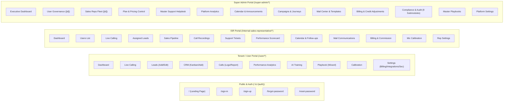
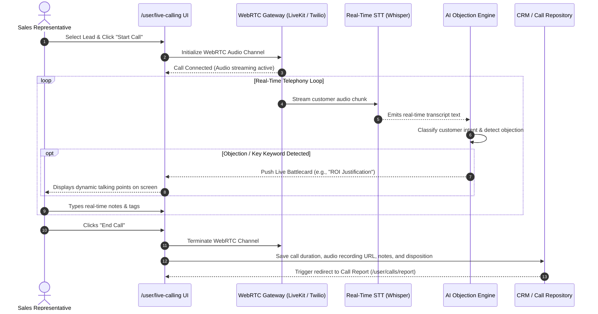
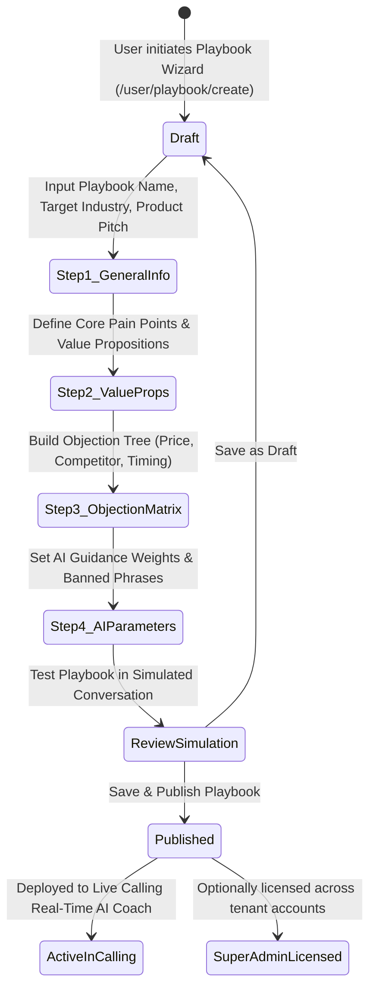
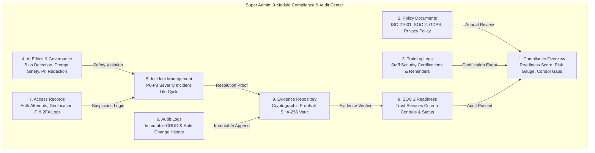
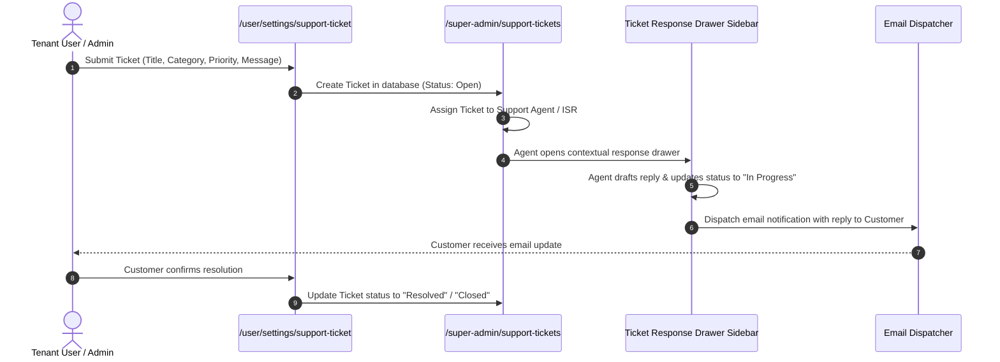
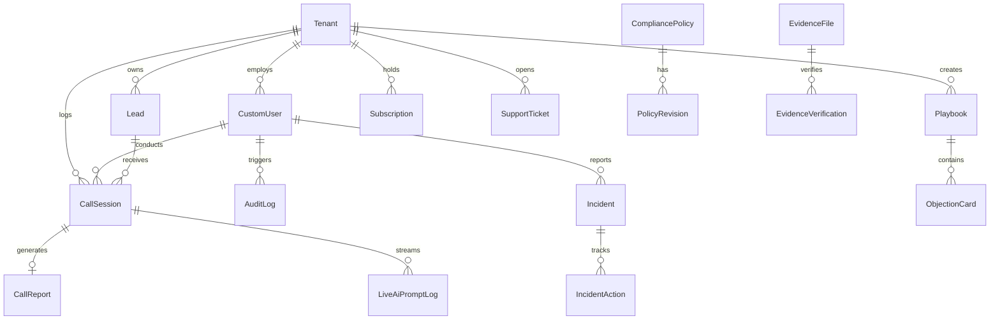

# PitchProX — Master Project Requirements, User Flows & Backend Specification

> **Document Status:** Unified Master Handover Specification & Architecture Blueprint  
> **Audience:** Incoming Frontend Engineers, Backend / Python / Node Development Team, DevOps, Product Managers, QA Engineers  
> **Tech Stack:**  
> - **Frontend:** Next.js 16 (App Router), React 19, Tailwind CSS v4 (`@theme`), Framer Motion, Recharts, React Hook Form, TanStack Query, Axios, Lucide React, React Icons, Swiper (🟢 **100% Complete UI & Client Components**)  
> - **Backend Target:** Django 5.x / FastAPI / Node.js, Django REST Framework (DRF) / Fastify, SimpleJWT / OAuth2, PostgreSQL, Redis / Celery, WebSockets (Django Channels / Socket.io), AWS S3 / Cloudflare R2, WebRTC Voice Server (LiveKit / Twilio), OpenAI / Anthropic LLMs, Whisper Speech-to-Text.

---

## Master Table of Contents

1. [Part I: Platform Requirements & Multi-Role Scope](#part-i-platform-requirements--multi-role-scope)
   - [1.1 Platform Overview & Three-Tiered Vision](#11-platform-overview--three-tiered-vision)
   - [1.2 Customer / Tenant Admin Scope (`/user`)](#12-customer--tenant-admin-scope)
   - [1.3 Internal Sales Representative Scope (`/internal-sales-representative`)](#13-internal-sales-representative-scope)
   - [1.4 Super Administrator Scope (`/super-admin`)](#14-super-administrator-scope)
   - [1.5 AI Capabilities & Real-Time Telephony Matrix](#15-ai-capabilities--real-time-telephony-matrix)
   - [1.6 End-to-End User Journeys](#16-end-to-end-user-journeys)
   - [1.7 Core Product Logic & Business Rules](#17-core-product-logic--business-rules)
   - [1.8 Navigation Specifications (All Portals)](#18-navigation-specifications)
2. [Part II: Implementation Status, Progress Scorecard & Task Tracker](#part-ii-implementation-status-progress-scorecard--task-tracker)
   - [2.1 Executive Summary Scorecard](#21-executive-summary-scorecard)
   - [2.2 Dual-Layer Task Tracker (Frontend Done vs. Backend Pending)](#22-dual-layer-task-tracker)
3. [Part III: End-to-End Visual User Flows (Mermaid Diagrams)](#part-iii-end-to-end-visual-user-flows)
   - [3.1 Master System Architecture & Role Routing](#31-master-system-architecture--role-routing)
   - [3.2 Live Calling & Voice AI Stream Sequence](#32-live-calling--voice-ai-stream-sequence)
   - [3.3 Playbook Builder & AI Training Lifecycle](#33-playbook-builder--ai-training-lifecycle)
   - [3.4 9-Module Compliance & SOC 2 Audit State Machine](#34-9-module-compliance--soc-2-audit-state-machine)
   - [3.5 Support Ticket & Email Journey Flowchart](#35-support-ticket--email-journey-flowchart)
4. [Part IV: Page-by-Page Feature Specifications (Every Screen Explained)](#part-iv-page-by-page-feature-specifications)
   - [4.1 Public Marketing & Landing Experience (`/`)](#41-public-marketing--landing-experience)
   - [4.2 Authentication & Password Recovery Suite (`/(auth)/*`)](#42-authentication--password-recovery-suite)
   - [4.3 Customer / Tenant Admin Portal (All 10 Modules)](#43-customer--tenant-admin-portal)
   - [4.4 Internal Sales Representative (ISR) Portal (All 13 Modules)](#44-internal-sales-representative-isr-portal)
   - [4.5 Super Admin Platform Control Portal (All 14 Modules)](#45-super-admin-platform-control-portal)
   - [4.6 Compliance & Audit Suite Deep Dive (All 9 Submodules)](#46-compliance--audit-suite-deep-dive)
   - [4.7 Shared Component Ecosystem & Design System](#47-shared-component-ecosystem--design-system)
5. [Part V: Folder Structure & Component Directory Map](#part-v-folder-structure--component-directory-map)
6. [Part VI: Backend Architecture & Production Database Models](#part-vi-backend-architecture--production-database-models)
   - [6.1 Recommended Backend App Structure](#61-recommended-backend-app-structure)
   - [6.2 Entity Relationship Diagram (ERD)](#62-entity-relationship-diagram-erd)
   - [6.3 Production ORM Models (Python / Django)](#63-production-orm-models)
7. [Part VII: Complete REST & WebSocket API Catalog](#part-vii-complete-rest--websocket-api-catalog)
   - [7.1 Authentication & Profile APIs](#71-authentication--profile-apis)
   - [7.2 Live Calling & Telephony Session APIs](#72-live-calling--telephony-session-apis)
   - [7.3 Leads & CRM Pipeline APIs](#73-leads--crm-pipeline-apis)
   - [7.4 AI Training & Playbook APIs](#74-ai-training--playbook-apis)
   - [7.5 Compliance & Audit Suite APIs (All 9 Modules)](#75-compliance--audit-suite-apis)
   - [7.6 Billing, Quota & Credit Adjustment APIs](#76-billing-quota--credit-adjustment-apis)
   - [7.7 Real-Time WebSocket Protocols](#77-real-time-websocket-protocols)
8. [Part VIII: AI Service Contracts & Machine Learning Pipelines](#part-viii-ai-service-contracts--machine-learning-pipelines)
9. [Part IX: Developer Onboarding & Handover Protocol](#part-ix-developer-onboarding--handover-protocol)

---

# Part I: Platform Requirements & Multi-Role Scope

### 1.1 Platform Overview & Three-Tiered Vision
**PitchProX** is an enterprise AI Sales Enablement & Real-Time Call Intelligence SaaS platform. It automates high-velocity inbound/outbound tele-sales operations by combining:
1. **Live Web Dialing & Real-Time AI Coaching:** Streams speech audio, converts speech to text with millisecond latency, classifies customer intent/objections, and presents live battlecards directly on the rep's screen.
2. **Sales Playbook Engine & AI Fine-Tuning:** Lets businesses upload proprietary sales methodologies, competitor comparisons, pricing FAQs, and custom voice guidelines.
3. **Integrated CRM & Lead Pipeline:** Multi-stage prospect management with call recording logs, sentiment heatmaps, talk-to-listen ratios, and disposition tagging.
4. **Enterprise SOC 2 Compliance & Audit Governance:** A 9-module regulatory compliance suite managing access logs, immutable audit trails, ISO/SOC 2 policy documents, AI safety benchmarks, and cryptographic evidence archives.
5. **Multi-Role RBAC Governance:** Three distinct user personas: **Customer / Tenant Admin**, **Internal Sales Representative (ISR)**, and **Super Administrator**.

---

### 1.2 Customer / Tenant Admin Scope (`/user`)
* **Target User:** Business Owners, Sales Directors, Enterprise Account Managers subscribing to PitchProX.
* **Core Capabilities:**
  - **Live Calling Console (`/user/live-calling`):** WebRTC softphone with live AI objection prompts, notes taker, status updater, callback scheduler, and minute purchase modal.
  - **Lead Management (`/user/leads`):** Search, filter, add individual leads, edit lead attributes, and trigger instant calls.
  - **CRM Pipeline (`/user/crm`):** Visual prospect stage tracker (New, Contacted, Qualified, Proposal, Closed Won/Lost).
  - **Calls & Sentiment Intelligence (`/user/calls` & `/report`):** Audio waveform playback, full speaker-separated transcript search, sentiment scoring, and prompt adherence metrics.
  - **AI Training Center (`/user/ai-training`):** Custom business guidelines, dataset logs, voice persona parameters, and training progress gauges.
  - **Sales Playbook Builder (`/user/playbook` & `/create`):** Multi-step wizard creating pitch scripts, objection trees, pricing tables, and value propositions.
  - **Microphone & Voice Calibration (`/user/calibration`):** Hardware latency check, input gain calibration, noise cancellation verification.
  - **Performance Analytics (`/user/performance-analytics`):** Rep leaderboards, call duration trends, conversion momentum, trust gain score.
  - **Tenant Settings & Subscriptions (`/user/settings/*`):** Profile, Billing & Invoices, CRM Integrations (HubSpot, Salesforce), Notifications, Security (2FA), Outbound Mailer, and Support Tickets.

---

### 1.3 Internal Sales Representative Scope (`/internal-sales-representative`)
* **Target User:** PitchProX internal SDRs/BDRs and contracted tele-sales agents handling platform demo outreach and client campaigns.
* **Core Capabilities:**
  - **ISR Dashboard (`/internal-sales-representative/dashboard`):** Daily call quotas, connect rates, conversion momentum, active alerts, and upcoming callbacks.
  - **Queue-Driven Live Dialing (`/live-calling`):** Dedicated high-velocity dialer with AI assist cards and instant disposition tagging.
  - **Assigned Leads & CRM (`/leads` & `/crm`):** Leads allocated to the active representative with complete touchpoint histories.
  - **Audio Calibration Studio (`/calibration`):** Pre-shift audio check ensuring zero echo, clear mic capture, and low latency.
  - **Client Portal Viewer (`/users` & `/user-portal`):** Contextual inspection of assigned client accounts and usage.
  - **Communications (`/mail` & `/calendar`):** Templated follow-up emails, scheduled callback reminders.
  - **Support Escalations (`/support-tickets`):** Client issue ticketing and resolution tracking.

---

### 1.4 Super Administrator Scope (`/super-admin`)
* **Target User:** Executive leadership, platform operations, compliance officers, and system administrators.
* **Core Capabilities:**
  - **Executive Platform Dashboard (`/super-admin/dashboard`):** Global MRR/ARR, tenant growth momentum, AI prompt adherence, top sales reps, business insights, employee roster, and operational alerts.
  - **Tenant & User Management (`/super-admin/users` & `/[id]`):** Platform-wide account administration, minute quota grants, seat adjustments, and tenant usage logs.
  - **Sales Rep Fleet Governance (`/super-admin/sales-reps` & `/[id]`):** Rep rosters, lead allocation engine, and individual conversion scorecards.
  - **Plan, Pricing & Playbook Licensing (`/plan-pricing-control` & `/manage-playbooks`):** Subscription tier configurations, minute rates, add-on costs, and global master playbook distribution.
  - **Compliance & Audit Center (`/super-admin/compliance-audit/*`):** Full 9-module compliance engine (Overview, Policies, Training Logs, AI Ethics, Incidents, Audit Logs, Access Records, SOC 2 Readiness, Evidence Repository).
  - **Campaigns & Marketing Journeys (`/campaigns-journeys`):** Lifecycle workflows, dynamic user segments, and multi-channel notification templates.
  - **Billing & Credit Adjustment Suite (`/billing` & `/credits-adjustments`):** Platform revenue, payment gateway logs, manual minute balance credits/debits.
  - **Global Helpdesk (`/support-tickets` & `/mail`):** Platform-wide ticket triage and transactional mail logs.

---

### 1.5 AI Capabilities & Real-Time Telephony Matrix

| AI / Telephony Pipeline | Latency Target | Technology / Model | Business Output |
| :--- | :--- | :--- | :--- |
| **Real-Time Speech-to-Text** | `< 250ms` | OpenAI Whisper / Deepgram Nova-2 | Instant streaming transcript with speaker separation |
| **Objection Detection & Classification** | `< 400ms` | Claude 3.5 Sonnet / GPT-4o-mini | Triggering contextual battlecards (e.g. *Price Too High, Competitor X*) |
| **Dynamic Battlecard Recommendation** | `< 300ms` | Vector DB (pgvector / Pinecone) | Ranked talking points, rebuttals, and pricing ROI stats |
| **Call Sentiment & Trust Gain Scoring** | Post-Call Batch | NLP Sentiment Classifier | Sentiment trajectory, Trust Gain score (0-100), Talk-to-Listen ratio |
| **Automated Call Summary & Action Items**| Post-Call Batch | GPT-4o | Structured CRM notes, follow-up bullet points, key questions asked |
| **AI Sales Playbook Generation** | Real-Time UI | GPT-4o Multi-Step Agent | Comprehensive multi-chapter playbook from company URLs and notes |
| **AI Voice Calibration & Noise Filter** | Client-Side Audio | Web Audio API / RNNoise | Decibel level monitoring, mic frequency balance, echo cancellation |
| **SOC 2 Evidence Auto-Verification** | Scheduled Batch | Rule Engine & Hash Verification | Validates log immutability, backup checksums, policy signatures |

---

### 1.6 End-to-End User Journeys

```mermaid
flowchart TD
    subgraph Journey1["1. Tenant Admin Onboarding & Setup"]
        A1[Sign Up at /sign-up] --> A2[Login & Access /user/dashboard]
        A2 --> A3[Calibrate Mic at /user/calibration]
        A3 --> A4[Build Playbook at /user/playbook/create]
        A4 --> A5[Configure AI Training Guidelines at /user/ai-training]
        A5 --> A6[Import Leads at /user/leads]
    end

    subgraph Journey2["2. High-Velocity Calling & AI Pitching"]
        B1[Select Lead in /user/leads or /user/crm] --> B2[Initiate Call at /user/live-calling]
        B2 --> B3[AI Streams Live Transcripts & Objection Battlecards]
        B3 --> B4[Rep Logs Live Notes & Changes Disposition]
        B4 --> B5[End Call -> View Detailed Analytics at /user/calls/report]
    end

    subgraph Journey3["3. Super Admin Platform Oversight"]
        C1[Log In to /super-admin/dashboard] --> C2[Inspect Platform MRR & Operational Alerts]
        C2 --> C3[Adjust Tenant Quotas at /super-admin/billing/credits-adjustments]
        C3 --> C4[Review Compliance & SOC 2 at /super-admin/compliance-audit/overview]
        C4 --> C5[Manage Support Tickets at /super-admin/support-tickets]
    end

    Journey1 --> Journey2
```



---

### 1.7 Core Product Logic & Business Rules
1. **AI As An Assistant, Not An Auto-Dialing Bot:** PitchProX empowers human sales representatives by feeding real-time recommendations, leaving final conversational decisions to the human rep.
2. **Immutable Audit Trails:** Any action modifying user roles, deleting leads, granting minute credits, or altering compliance policies MUST append an immutable row to `AuditLog` with timestamp, actor ID, and IP address.
3. **Credit & Minutes Enforcement:** Active dialing sessions check available credit balance in real time. If balance reaches zero, the softphone triggers `PurchaseMoreModal` and prevents new outbound calls.
4. **Strict Multi-Tenant Data Isolation:** Tenant users only access leads, calls, playbooks, and recordings belonging to their tenant organization. Super Admins possess platform-wide supervisory read/write capabilities.
5. **SOC 2 Compliance Mandate:** Evidence uploaded to the repository is cryptographically hashed (SHA-256) upon upload to maintain audit integrity.

---

### 1.8 Navigation Specifications



---

# Part II: Implementation Status, Progress Scorecard & Task Tracker

### 2.1 Executive Summary Scorecard

| Module / Route Area | Frontend UI & State | Backend API & DB | Readiness Assessment |
| :--- | :---: | :---: | :--- |
| **Public Landing & Marketing (`/`)** | 🟢 **100% Complete** | 🟡 **Static / Ready** | Interactive demo preview, dynamic guidance, pricing, FAQ ready |
| **Authentication & Password Recovery (`/(auth)/*`)** | 🟢 **100% Complete** | 🔴 **Pending** | Forms, validation, Google SSO UI ready; needs JWT token endpoints |
| **Tenant Dashboard (`/user/dashboard`)** | 🟢 **100% Complete** | 🔴 **Pending** | Conversion stats, pipeline bar, recent calls UI ready; needs metrics API |
| **Tenant Live Calling (`/user/live-calling`)** | 🟢 **100% Complete** | 🔴 **Pending** | Dialer UI, AI cue cards, note taking, modals ready; needs WebRTC / WS |
| **Tenant Leads Management (`/user/leads/*`)** | 🟢 **100% Complete** | 🔴 **Pending** | Filterable table, Add Lead, Edit Lead ready; needs CRUD API |
| **Tenant CRM Pipeline (`/user/crm/*`)** | 🟢 **100% Complete** | 🔴 **Pending** | Pipeline status cards, Add Prospect form ready; needs CRM API |
| **Tenant Call History & Reports (`/user/calls/*`)** | 🟢 **100% Complete** | 🔴 **Pending** | Audio player UI, transcript search, sentiment report ready; needs audio API |
| **Tenant AI Training Center (`/user/ai-training`)** | 🟢 **100% Complete** | 🔴 **Pending** | Rule weights, progress bar, guideline modal ready; needs dataset API |
| **Tenant Playbook Engine (`/user/playbook/*`)** | 🟢 **100% Complete** | 🔴 **Pending** | Multi-step Playbook Wizard, objection cards ready; needs playbook API |
| **Tenant Calibration (`/user/calibration`)** | 🟢 **100% Complete** | 🟡 **Client Ready** | Web Audio decibel testing, latency tester UI complete |
| **Tenant Settings & Billing (`/user/settings/*`)** | 🟢 **100% Complete** | 🔴 **Pending** | Profile, Security, Notifications, Invoices, Integrations ready |
| **ISR Dashboard & Queue (`/internal-sales-representative/*`)** | 🟢 **100% Complete** | 🔴 **Pending** | Daily targets, assigned leads, softphone, mail, tickets ready |
| **Super Admin Dashboard (`/super-admin/dashboard`)** | 🟢 **100% Complete** | 🔴 **Pending** | Revenue charts, roster, business insights, alerts ready; needs metrics API |
| **Super Admin Users & Reps (`/super-admin/users`, `/sales-reps`)** | 🟢 **100% Complete** | 🔴 **Pending** | Detailed user inspection, rep scorecards, lead assignment UI ready |
| **Super Admin Plan & Pricing (`/super-admin/plan-pricing-control`)** | 🟢 **100% Complete** | 🔴 **Pending** | Plan editor, playbook licensing tables ready; needs plan config API |
| **Super Admin Billing & Credits (`/super-admin/billing/*`)** | 🟢 **100% Complete** | 🔴 **Pending** | Revenue table, manual credit adjustment modal ready; needs balance API |
| **Super Admin Compliance Suite (All 9 Submodules)** | 🟢 **100% Complete** | 🔴 **Pending** | Scorecards, policy docs, training logs, AI ethics, incidents, audit logs, access records, SOC 2, evidence vault complete |
| **Super Admin Campaigns & Mail (`/super-admin/campaigns-journeys`, `/mail`)** | 🟢 **100% Complete** | 🔴 **Pending** | Journey builder, segments, template editor, email viewer complete |
| **Super Admin Support Helpdesk (`/super-admin/support-tickets`)** | 🟢 **100% Complete** | 🔴 **Pending** | Ticket queue, drawer response sidebar, status transitions complete |

---

### 2.2 Dual-Layer Task Tracker

#### Layer A: Frontend Implementation (STATUS: 🟢 100% COMPLETE)
- [x] Next.js 16 App Router setup with React 19 and Tailwind CSS v4 design tokens.
- [x] Public marketing suite with interactive dynamic conversation player and pricing tier switcher.
- [x] Auth layout with Framer Motion customer review carousel and credential validation.
- [x] Universal Sidebar component (`src/components/shared/sidebar/sidebar.jsx`) with nested submenu support, spring transitions, and active route matching.
- [x] Universal Header component (`src/components/shared/header/header.jsx`) with notification popover, search, and profile dropdown.
- [x] Complete Tenant User workspace (10 core modules + modals).
- [x] Complete Internal Sales Representative workspace (13 core modules).
- [x] Complete Super Admin platform governance workspace (14 modules).
- [x] All 9 Compliance & Audit sub-modules implemented with statistics headers and data tables.
- [x] Modals for live call controls, note taking, status updates, callbacks, and minute purchases.
- [x] Multi-step Playbook Creation Wizard with objection handling matrices.

#### Layer B: Backend Implementation (STATUS: 🔴 PENDING — FOR BACKEND TEAM)
- [ ] **Core Setup:** Django 5.x / FastAPI / Node.js backend with PostgreSQL, Redis, and Celery.
- [ ] **Authentication Services:** Custom User model, JWT access/refresh token rotation, Google OAuth2 callback handler.
- [ ] **Telephony & WebRTC Server:** LiveKit / Twilio voice gateway with bidirectional WebSocket audio stream.
- [ ] **Real-Time AI Speech Pipeline:** Streaming STT (Whisper/Deepgram) -> LLM classifier (Claude/GPT-4o) -> dynamic objection battlecard pusher.
- [ ] **Leads & CRM Store:** CRUD APIs for leads, interaction history, stage transitions, and bulk CSV ingestion.
- [ ] **Playbook & Training Engine:** Endpoints for saving structured playbook JSON and fine-tuning guidelines.
- [ ] **Compliance & Audit Engine:** Immutable audit logging middleware, S3 SHA-256 evidence vault upload, incident ticket workflow.
- [ ] **Billing & Stripe Webhooks:** Subscription management, credit balance tracking, manual credit adjustment API.
- [ ] **Email & Notification Service:** Celery email dispatch workers for ticket alerts, marketing journeys, and invitations.

---

# Part III: End-to-End Visual User Flows

### 3.1 Master System Architecture & Role Routing

```mermaid
flowchart TB
    ClientReq([Client / Browser Request]) --> ProxyLayer[Proxy Middleware / Next.js Routing]
    
    ProxyLayer --> PublicArea[Public / Marketing Portal /]
    ProxyLayer --> AuthGroup[Auth Group /(auth)/*]
    
    AuthGroup --> AuthCheck{Auth & Role Check}
    AuthCheck -->|Role: Super Admin| SuperAdminPortal[/super-admin/*]
    AuthCheck -->|Role: Internal Sales Rep| ISRPortal[/internal-sales-representative/*]
    AuthCheck -->|Role: Tenant User / Admin| UserPortal[/user/*]

    subgraph UserPortalSub["Tenant User Portal Capabilities"]
        U1[Live Softphone Dialing]
        U2[Leads & CRM Kanban]
        U3[Call History & Sentiment Reports]
        U4[AI Training & Guidelines]
        U5[Playbook Creation Wizard]
        U6[Microphone Calibration]
    end

    subgraph SuperAdminSub["Super Admin Governance"]
        S1[Platform Metrics & MRR]
        S2[Plan & Pricing Control]
        S3[9-Module Compliance & Audit Suite]
        S4[Tenant & Rep Administration]
        S5[Billing & Credit Top-ups]
    end

    UserPortal --> UserPortalSub
    SuperAdminPortal --> SuperAdminSub
```

---

### 3.2 Live Calling & Voice AI Stream Sequence



---

### 3.3 Playbook Builder & AI Training Lifecycle



---

### 3.4 9-Module Compliance & SOC 2 Audit State Machine



---

### 3.5 Support Ticket & Email Journey Flowchart



---

# Part IV: Page-by-Page Feature Specifications

### 4.1 Public Marketing & Landing Experience (`/`)
* **Route:** `src/app/(public)/page.js`
* **Components:**
  - **Header (`header.jsx`):** Navigation links (Features, How It Works, Pricing, FAQ), Sign In / Get Started buttons.
  - **Hero (`hero.jsx`):** Headline, subtext, interactive email lead capture field, animated badges.
  - **Live AI Conversation Demo (`conversation.jsx` & `adapt-conversation.jsx`):** Simulated call interface with dynamic talking points and live objection cards.
  - **Guidance & Features (`guidance.jsx` & `how-it-works.jsx`):** 4-step breakdown of speech intelligence, playbook integration, and analytics.
  - **Interactive Pricing Matrix (`pricing.jsx`):** Monthly vs. Annual toggle with discount pill, Starter/Pro/Enterprise tier cards with feature lists.
  - **Interactive FAQ Accordion (`faq.jsx`):** Expandable answers for security, AI accuracy, integrations, and telephony setups.
  - **Demo Request Modal (`demo.jsx` & `demo-form.jsx`):** Lead capture dialog for enterprise prospects.
  - **Footer (`footer.jsx`):** Multi-column footer with policy links and social channels.

---

### 4.2 Authentication & Password Recovery Suite (`/(auth)/*`)
* **Layout (`src/app/(auth)/layout.js`):** Split-screen design. Left side renders the active form card; right side renders an animated Framer Motion testimonial slider with real customer ratings.
* **Sign In (`/sign-in`):** Email and password inputs, Remember Me toggle, Google Single Sign-On button (`@react-oauth/google`), redirect to corresponding role portal.
* **Sign Up (`/sign-up`):** Account registration with full name, company name, work email, password strength meter, and terms agreement.
* **Forgot Password (`/forgot-password`):** Email submission form that triggers recovery email token dispatch.
* **Reset Password (`/reset-password`):** New password and confirmation form with token validation.

---

### 4.3 Customer / Tenant Admin Portal (All 10 Modules)

#### 1. Dashboard (`/user/dashboard`)
* **Components:** `PerformanceHeader` with greeting, `PerformanceStatsGrid` (Conversion Momentum, Prompt Adherence, Trust Gain, Lead to Subscription), `PerformanceTrend` (interactive Recharts area chart), `LeadPipeline` (visual lead stages), and `RecentCalls` (table of recent calls with audio preview).

#### 2. Live Calling Console (`/user/live-calling`)
* **Components:**
  - Softphone interface with active call duration timer, lead metadata (name, company, phone).
  - Real-time AI guidance cards showing live recommended talking points.
  - Quick action toolbar: Add Note Modal (`add-note-modal.jsx`), Update Status Modal (`update-status-modal.jsx`), Schedule Follow-up Modal (`schedule-followup-modal.jsx`), Purchase More Minutes Modal (`purchase-more-modal.jsx`), End Call Summary (`end-call.jsx`).

#### 3. Leads Management (`/user/leads`, `/add`, `/edit`)
* **Components:** Filterable lead table with status badges (`New`, `Contacted`, `Qualified`, `Proposal`, `Won`), bulk CSV import trigger, Add Lead form (`/leads/add`), Edit Lead form (`/leads/edit`), one-click call trigger.

#### 4. CRM Pipeline (`/user/crm`, `/add`)
* **Components:** Multi-stage prospect pipeline view, prospect conversion cards, stage-drag triggers, and Add Prospect form (`/crm/add`).

#### 5. Calls & Sentiment Intelligence (`/user/calls`, `/report`)
* **Components:** Call log table with duration, agent name, disposition tag, and recording download.
* **Call Report Page (`/user/calls/report`):** Waveform audio player, synchronized full transcript with speaker labels, sentiment trajectory graph, and prompt adherence score.

#### 6. Performance Analytics (`/user/performance-analytics`)
* **Components:** KPI metric cards, Rep performance leaderboards, call volume by hour bar charts, conversion rate percentages over time.

#### 7. AI Training Center (`/user/ai-training`)
* **Components:** AI Training progress bar (`ai-training-progress.jsx`), Training content list (`ai-training-content-list.jsx`), AI Guideline Drawer/Modal (`ai-guidline-modal.jsx`), rule weights tuner.

#### 8. Sales Playbook Builder (`/user/playbook`, `/create`)
* **Components:** Playbook repository cards, objection handling library, and the **Multi-Step Playbook Wizard (`/user/playbook/create`)** supporting general info, value propositions, script trees, and AI constraints.

#### 9. Microphone & Audio Calibration (`/user/calibration`)
* **Components:** Web Audio API decibel gauge, latency tester, input gain slider, background noise level check, and test audio playback.

#### 10. Tenant Settings (`/user/settings/*`)
* **Sub-routes:**
  - `/user/settings/profile`: Account and company settings.
  - `/user/settings/billing`: Active subscription plan, quota usage, and invoice history (`/billing/history`).
  - `/user/settings/integrations`: CRM sync cards (Salesforce, HubSpot, Zapier, Webhooks).
  - `/user/settings/security`: Password management, 2FA setup, active sessions.
  - `/user/settings/notifications`: Alert preferences for calls, billing, and leads.
  - `/user/settings/preferences`: Timezone, language, and dialer presets.
  - `/user/settings/send-mail`: Outbound email composer, templates (`/templates`, `/[id]`), and sent logs (`/emails`, `/[id]`).
  - `/user/settings/support-ticket`: Tenant support desk ticket creation and status list (`/tickets`).

---

### 4.4 Internal Sales Representative (ISR) Portal (All 13 Modules)

1. **Dashboard (`/internal-sales-representative/dashboard`):** Daily call quota dials, connect rates, conversion momentum, employee roster, operational alerts, and recent activity.
2. **Users / Client Directory (`.../users`):** Assigned customer client list.
3. **Live Calling Softphone (`.../live-calling`):** High-velocity softphone dialer with real-time AI prompt cards.
4. **Assigned Leads (`.../leads`):** Leads queue prioritized by callback time and score.
5. **CRM Pipeline (`.../crm`):** Prospect qualification stages.
6. **Call Logs (`.../calls`):** Rep call history with self-coaching review scores.
7. **Support Tickets (`.../support-tickets`):** Assigned escalation tickets with response sidebar.
8. **Performance Analytics (`.../performance-analytics`):** Individual KPI cards, talk-to-listen ratios, and commission tracker.
9. **Calendar (`.../calendar`):** Follow-up meeting scheduler with calendar view.
10. **Mail Center (`.../mail`):** Email drafting and client communication inbox.
11. **Billing & Quota (`.../billing`):** Monthly quota achievement and commission calculations.
12. **Microphone Calibration (`.../calibration`):** Audio device check prior to starting dial sessions.
13. **Settings (`.../settings/profile`):** Personal profile, availability status, and audio preferences.

---

### 4.5 Super Admin Platform Control Portal (All 14 Modules)

1. **Executive Dashboard (`/super-admin/dashboard`):** Platform MRR, Conversion Momentum, Prompt Adherence, Trust Gain, Performance Trends, Top Sales Reps, Business Insights (8 cards), User Search, Employee Roster, Operational Alerts, Recent Activity.
2. **Users Management (`/super-admin/users`, `/[id]`):** Platform-wide tenant roster with plan badges, seat counts, quota balances, and deep-dive user detail view (`/users/[id]`).
3. **Sales Reps Fleet Governance (`/super-admin/sales-reps`, `/[id]`):** Representative directory, conversion rankings, and individual rep scorecards (`/sales-reps/[id]`).
4. **Plan & Pricing Control (`/super-admin/plan-pricing-control`):** Subscription tiers, monthly/annual rates, per-minute calling rates, feature flags, and Master Playbook licensing (`/manage-playbooks`).
5. **Support Helpdesk Center (`/super-admin/support-tickets`):** Master ticket queue, priority filters, and ticket response drawer (`src/components/sidebars/support-ticket-sidebar.jsx`).
6. **Platform Performance Analytics (`/super-admin/performance-analytics`):** Cross-tenant AI metrics, objection handle rates, voice latency benchmarks.
7. **Calendar & Announcements (`/super-admin/calendar-announcements` & `/calendar`):** Platform maintenance announcements and scheduling calendar.
8. **Campaigns & Marketing Journeys (`/super-admin/campaigns-journeys`):** Customer lifecycle campaigns, user segments (`/segments`), and message templates (`/templates`).
9. **Mail Center (`/super-admin/mail`):** Outbound email monitor, template builder (`/templates`), sent email logs (`/emails`, `/[id]`), and ticket correspondences (`/tickets`).
10. **Billing & Financial Management (`/super-admin/billing`):** Platform revenue, payment gateway transactions, and manual credit adjustments (`/billing/credits-adjustments`).
11. **Compliance & Audit Center (`/super-admin/compliance-audit/*`):** 9-module compliance engine (detailed below in 4.6).
12. **Master Playbook Engine (`/super-admin/playbook`):** Global sales playbook creator and master repository.
13. **Platform Settings (`/super-admin/settings/*`):** Profile, Security, Notifications, Preferences, Integrations.
14. **Alias Calendar (`/super-admin/calendar`):** Quick-access calendar alias.

---

### 4.6 Compliance & Audit Suite Deep Dive (All 9 Submodules)

Located under `src/app/super-admin/compliance-audit/`:

```
compliance-audit/
├── overview/             # 1. Compliance Overview
├── policy-documents/     # 2. Policy Documents
├── training-logs/        # 3. Training Logs
├── ai-governance/        # 4. AI Ethics & Governance
├── incident-management/  # 5. Incident Management
├── audit-logs/           # 6. Audit Logs
├── access-records/       # 7. Access Records
├── soc2-readiness/       # 8. SOC 2 Readiness
└── evidence-repository/  # 9. Evidence Repository
```

1. **Compliance Overview (`/overview`):** Displays readiness score gauge (e.g. `94%`), active control status breakdown (Pass, Warning, Fail), upcoming regulatory review dates.
2. **Policy Documents (`/policy-documents`):** Table of formal corporate policies (Information Security Policy, Data Retention, Acceptable Use, Incident Response), versioning tags, PDF download, and approval audit status.
3. **Training Logs (`/training-logs`):** Employee compliance training completion table, certification scores, completion dates, and automatic recertification reminder triggers.
4. **AI Ethics & Governance (`/ai-governance`):** AI safety benchmarks, bias detection scores, prompt injection defenses, and PII redaction compliance metrics.
5. **Incident Management (`/incident-management`):** Security incident tracking table with severity pills (P0-Critical, P1-High, P2-Medium, P3-Low), SLA countdowns, root cause notes, and resolution actions.
6. **Audit Logs (`/audit-logs`):** Immutable table recording every admin action, actor name, timestamp, resource touched, IP address, and change payload diff.
7. **Access Records (`/access-records`):** Login access history table recording authentication outcomes (Success/Failed), 2FA methods used, IP geolocation, and device user-agents.
8. **SOC 2 Readiness (`/soc2-readiness`):** Trust Services Criteria tracker (Security, Availability, Confidentiality, Processing Integrity, Privacy), control verification toggles, and auditor review notes.
9. **Evidence Repository (`/evidence-repository`):** Secure cryptographic vault for storing penetration test reports, backup verification logs, infrastructure screenshots, and SHA-256 validation hashes.

---

### 4.7 Shared Component Ecosystem & Design System

* **Color Palette (`src/app/globals.css` via `@theme`):**
  - `--color-primary`: `#0EADAB` (PitchProX Teal)
  - `--color-secondary`: `#22E2B9` (Mint Accent)
  - `--color-dark-black`: `#080C1D` (Deep Navy Black for sidebars)
  - `--color-light-gray`: `#F5F5F5` (Dashboard background canvas)
  - `--color-foreground`: `#2B3D39` (Slate Green body text)
  - `--color-green`: `#3BB515` (Success & High Conversion)
  - `--color-red`: `#FF4842` (Critical Alerts & Errors)
* **Universal Sidebar (`src/components/shared/sidebar/sidebar.jsx`):**
  - Framer Motion spring transition: `{ type: "spring", stiffness: 120, damping: 24 }`.
  - Supports nested collapsible submenus with `ChevronDown` rotation.
  - Automatically highlights parent and sub-item routes based on active pathname.
  - Desktop fixed sidebar (`lg:w-64`) with mobile responsive slide-over drawer and backdrop overlay.
* **Universal Header (`src/components/shared/header/header.jsx`):**
  - Notification popover with unread indicator badge.
  - Global search bar input.
  - User profile avatar dropdown with role badge.
* **Universal Tables & Pagination (`src/components/shared/pagination`):**
  - Unified rounded table styling with page count, page-size dropdown, and previous/next navigation buttons.

---

# Part V: Folder Structure & Component Directory Map

```
pitchprox-dev/
├── public/                               # Public static assets & images
├── src/
│   ├── app/                              # Next.js 16 App Router Directory
│   │   ├── (auth)/                       # Authentication Route Group
│   │   │   ├── forgot-password/          # Forgot password page
│   │   │   ├── layout.js                 # Auth split layout with review slider
│   │   │   ├── reset-password/           # Reset password token page
│   │   │   ├── sign-in/                  # Sign in page (Email + Google SSO)
│   │   │   └── sign-up/                  # Tenant onboarding registration
│   │   │
│   │   ├── (public)/                     # Public Marketing Portal
│   │   │   ├── components/               # Landing page sections:
│   │   │   │   ├── adapt-conversation.jsx# Dynamic pitch & objection visualizer
│   │   │   │   ├── conversation.jsx      # Voice conversation preview card
│   │   │   │   ├── demo.jsx & demo-form  # Demo request dialog
│   │   │   │   ├── faq.jsx               # Accordion FAQ component
│   │   │   │   ├── footer.jsx            # Multi-column footer
│   │   │   │   ├── guidance.jsx          # AI guidance highlights
│   │   │   │   ├── header.jsx            # Public top navigation
│   │   │   │   ├── hero.jsx              # Hero banner with lead capture
│   │   │   │   ├── how-it-works.jsx      # Step-by-step feature walkthrough
│   │   │   │   └── pricing.jsx           # Monthly/Annual pricing switcher
│   │   │   └── page.js                   # Landing page entry point
│   │   │
│   │   ├── internal-sales-representative/# ISR Role Portal (13 sub-routes)
│   │   │   ├── layout.js                 # ISR layout & sidebar navigation
│   │   │   ├── dashboard/                # Rep KPI overview & targets
│   │   │   ├── live-calling/             # Outbound softphone dialer
│   │   │   ├── leads/                    # Assigned leads queue
│   │   │   ├── crm/                      # Sales qualification pipeline
│   │   │   ├── calls/                    # Call recordings & scores
│   │   │   ├── support-tickets/          # Client tickets assigned to ISR
│   │   │   ├── performance-analytics/    # Personal KPIs & talk ratios
│   │   │   ├── calendar/                 # Callback scheduler
│   │   │   ├── mail/                     # Email communications
│   │   │   ├── billing/                  # Quota & commission tracking
│   │   │   ├── calibration/              # Audio hardware testing
│   │   │   ├── users/                    # Client accounts roster
│   │   │   ├── user-portal/              # Read-only client view
│   │   │   └── settings/                 # Rep account settings
│   │   │
│   │   ├── super-admin/                  # Super Admin Platform Governance
│   │   │   ├── layout.js                 # Admin layout with nested menu support
│   │   │   ├── dashboard/                # Global MRR & operational alerts
│   │   │   ├── users/                    # Platform tenants & user management
│   │   │   │   └── [id]/                 # Tenant deep-dive inspection
│   │   │   ├── sales-reps/               # Sales rep fleet management
│   │   │   │   └── [id]/                 # Individual rep scorecard
│   │   │   ├── plan-pricing-control/     # Subscription tiers & pricing
│   │   │   │   └── manage-playbooks/     # Global playbook licensing
│   │   │   ├── support-tickets/          # Master helpdesk ticket queue
│   │   │   ├── performance-analytics/    # Global AI adherence & metrics
│   │   │   ├── calendar-announcements/   # Announcements & schedule
│   │   │   ├── campaigns-journeys/       # Marketing journeys
│   │   │   │   ├── segments/             # User segmentation
│   │   │   │   └── templates/            # Journey notification templates
│   │   │   ├── mail/                     # Global mail center & logs
│   │   │   ├── billing/                  # Revenue reporting
│   │   │   │   └── credits-adjustments/  # Manual credit top-ups & grants
│   │   │   ├── compliance-audit/         # 9-Module Compliance Engine:
│   │   │   │   ├── overview/             # Compliance scorecard & gauge
│   │   │   │   ├── policy-documents/     # Versioned security policies
│   │   │   │   ├── training-logs/        # Employee training records
│   │   │   │   ├── ai-governance/        # AI ethics & prompt safety
│   │   │   │   ├── incident-management/  # Security incident tickets
│   │   │   │   ├── audit-logs/           # Immutable admin action trail
│   │   │   │   ├── access-records/       # Login & 2FA access records
│   │   │   │   ├── soc2-readiness/       # Trust Services Criteria controls
│   │   │   │   └── evidence-repository/  # Cryptographic evidence vault
│   │   │   ├── playbook/                 # Master sales playbook library
│   │   │   └── settings/                 # Platform settings
│   │   │
│   │   ├── user/                         # Customer / Tenant Admin Portal
│   │   │   ├── layout.js                 # Tenant workspace layout & sidebar
│   │   │   ├── dashboard/                # Real-time metrics & recent calls
│   │   │   ├── live-calling/             # Softphone with live AI coach
│   │   │   ├── leads/                    # Lead manager (Add/Edit/CSV)
│   │   │   │   ├── add/                  # Add lead form
│   │   │   │   └── edit/                 # Edit lead form
│   │   │   ├── crm/                      # Kanban prospect pipeline
│   │   │   │   └── add/                  # Add prospect form
│   │   │   ├── calls/                    # Call history table
│   │   │   │   └── report/               # Call sentiment & audio report
│   │   │   ├── performance-analytics/    # Team conversion & duration stats
│   │   │   ├── ai-training/              # AI guidelines & fine-tuning
│   │   │   ├── playbook/                 # Playbook library
│   │   │   │   └── create/               # Multi-step Playbook Wizard
│   │   │   ├── calibration/              # Mic decibel & latency calibration
│   │   │   └── settings/                 # Tenant configuration:
│   │   │       ├── profile/              # Account & company details
│   │   │       ├── billing/              # Subscription & invoice history
│   │   │       ├── integrations/         # CRM sync (Salesforce, HubSpot)
│   │   │       ├── security/             # 2FA, password, sessions
│   │   │       ├── notifications/        # Alert preferences
│   │   │       ├── preferences/          # Timezone & dialer presets
│   │   │       ├── send-mail/            # Outbound email sender
│   │   │       └── support-ticket/       # Tenant helpdesk submission
│   │   │
│   │   ├── globals.css                   # Tailwind v4 theme variables & tokens
│   │   ├── layout.js                     # Root HTML wrapper
│   │   ├── loading.js                    # Global loading skeleton
│   │   └── not-found.js                  # 404 Error page
│   │
│   ├── assets/                           # Branding logos and graphics
│   │   └── logos/                        # PitchProX logo variants
│   ├── components/                       # Shared component ecosystem
│   │   ├── buttons/                      # Standardized action buttons
│   │   ├── forms/                        # Input fields, selects, toggles
│   │   ├── layout/                       # Page containers and wrappers
│   │   ├── modals/                       # Modals, dialogs, action popups
│   │   ├── shared/                       # Cross-portal components:
│   │   │   ├── header/                   # Header with search & notifications
│   │   │   ├── sidebar/                  # Framer Motion animated sidebar
│   │   │   ├── pagination/               # Table pagination controls
│   │   │   ├── dropdown/                 # Dropdown select menus
│   │   │   ├── calendar/                 # Shared calendar component
│   │   │   └── under-maintenance.jsx     # Under construction state
│   │   ├── sidebars/                     # Drawers (Support ticket sidebar)
│   │   ├── texts/                        # Standardized typography
│   │   ├── ui/                           # Badges, pills, avatars
│   │   └── wrappers/                     # Motion wrappers & cards
│   │
│   ├── hooks/                            # Custom React hooks
│   ├── lib/                              # Utility functions & API client
│   ├── providers/                        # QueryClient & OAuth providers
│   └── proxy.js                          # Route middleware configuration
│
├── package.json                          # Dependencies & NPM scripts
└── README.md                             # Project overview
```

---

# Part VI: Backend Architecture & Production Database Models

### 6.1 Recommended Backend App Structure

```
backend/
├── manage.py
├── core/                         # Settings, wsgi, asgi, routing
├── apps/
│   ├── accounts/                 # CustomUser, Tenant, Roles, JWT, 2FA
│   ├── telephony/                # WebRTC sessions, Live Calls, Recordings
│   ├── crm/                      # Leads, Prospects, Stages, Contacts
│   ├── playbooks/                # Playbooks, Objection Trees, Wizard Schemas
│   ├── ai_training/              # AI Guidelines, Datasets, Bias Rules
│   ├── compliance/               # 9 Modules: Policies, Logs, Audits, Incidents, Vault
│   ├── billing/                  # Subscriptions, Plans, Invoices, Credit Adjustments
│   ├── mail_center/              # Templates, Email Threads, Campaigns
│   ├── support/                  # Support Tickets, Comments, SLA Tracking
│   └── notifications/            # In-App Notifications & WebSockets
```

---

### 6.2 Entity Relationship Diagram (ERD)



---

### 6.3 Production ORM Models (Python / Django)

#### 1. Accounts & Multi-Tenant Model (`apps/accounts/models.py`)
```python
from django.contrib.auth.models import AbstractUser
from django.db import models

class Tenant(models.Model):
    name = models.CharField(max_length=255)
    slug = models.SlugField(unique=True)
    minute_balance = models.DecimalField(max_digits=10, decimal_places=2, default=500.00)
    plan_tier = models.CharField(max_length=50, default='Professional') # Starter, Professional, Enterprise
    created_at = models.DateTimeField(auto_now_add=True)

class CustomUser(AbstractUser):
    ROLE_CHOICES = (
        ('super_admin', 'Super Administrator'),
        ('isr', 'Internal Sales Representative'),
        ('tenant_admin', 'Tenant Administrator'),
        ('tenant_user', 'Tenant Standard User'),
    )
    role = models.CharField(max_length=30, choices=ROLE_CHOICES, default='tenant_user')
    tenant = models.ForeignKey(Tenant, on_delete=models.CASCADE, null=True, blank=True, related_name='users')
    avatar_url = models.URLField(blank=True, null=True)
    phone = models.CharField(max_length=50, blank=True)
    is_two_factor_enabled = models.BooleanField(default=False)
```

#### 2. Telephony & Live Calling (`apps/telephony/models.py`)
```python
from django.db import models
from apps.accounts.models import CustomUser, Tenant

class CallSession(models.Model):
    DISPOSITION_CHOICES = (
        ('interested', 'Interested / Proposal Sent'),
        ('callback', 'Scheduled Callback'),
        ('not_interested', 'Not Interested'),
        ('do_not_call', 'Do Not Call (DNC)'),
        ('voicemail', 'Left Voicemail'),
    )
    tenant = models.ForeignKey(Tenant, on_delete=models.CASCADE, related_name='calls')
    agent = models.ForeignKey(CustomUser, on_delete=models.SET_NULL, null=True, related_name='calls')
    lead = models.ForeignKey('crm.Lead', on_delete=models.CASCADE, related_name='calls')
    started_at = models.DateTimeField(auto_now_add=True)
    ended_at = models.DateTimeField(null=True, blank=True)
    duration_seconds = models.PositiveIntegerField(default=0)
    disposition = models.CharField(max_length=30, choices=DISPOSITION_CHOICES, blank=True)
    notes = models.TextField(blank=True)
    audio_recording_url = models.URLField(blank=True, null=True)

class CallReport(models.Model):
    call_session = models.OneToOneField(CallSession, on_delete=models.CASCADE, related_name='report')
    transcript = models.JSONField(default=list) # [{'speaker': 'agent', 'text': '...', 'timestamp': 1.2}]
    sentiment_score = models.FloatField(default=0.0) # -1.0 to +1.0
    prompt_adherence_score = models.IntegerField(default=85) # 0 to 100
    talk_to_listen_ratio = models.CharField(max_length=20, default='45/55')
    key_objections_raised = models.JSONField(default=list)
```

#### 3. CRM & Leads (`apps/crm/models.py`)
```python
from django.db import models
from apps.accounts.models import Tenant, CustomUser

class Lead(models.Model):
    STAGE_CHOICES = (
        ('new', 'New Lead'),
        ('contacted', 'Contacted'),
        ('qualified', 'Qualified'),
        ('proposal', 'Proposal Sent'),
        ('won', 'Closed Won'),
        ('lost', 'Closed Lost'),
    )
    tenant = models.ForeignKey(Tenant, on_delete=models.CASCADE, related_name='leads')
    assigned_to = models.ForeignKey(CustomUser, on_delete=models.SET_NULL, null=True, blank=True)
    first_name = models.CharField(max_length=100)
    last_name = models.CharField(max_length=100)
    company = models.CharField(max_length=255)
    email = models.EmailField()
    phone = models.CharField(max_length=50)
    stage = models.CharField(max_length=30, choices=STAGE_CHOICES, default='new')
    lead_score = models.IntegerField(default=50)
    custom_attributes = models.JSONField(default=dict)
    created_at = models.DateTimeField(auto_now_add=True)
```

#### 4. Sales Playbooks & AI Training (`apps/playbooks/models.py`)
```python
from django.db import models
from apps.accounts.models import Tenant

class Playbook(models.Model):
    tenant = models.ForeignKey(Tenant, on_delete=models.CASCADE, null=True, blank=True, related_name='playbooks')
    title = models.CharField(max_length=255)
    target_industry = models.CharField(max_length=150)
    is_master_template = models.BooleanField(default=False) # Super admin global master
    structure_json = models.JSONField(default=dict) # chapters, scripts, discovery questions
    ai_guidance_weights = models.JSONField(default=dict)
    created_at = models.DateTimeField(auto_now_add=True)

class ObjectionCard(models.Model):
    playbook = models.ForeignKey(Playbook, on_delete=models.CASCADE, related_name='objections')
    trigger_keyword = models.CharField(max_length=150)
    objection_title = models.CharField(max_length=255)
    recommended_rebuttal = models.TextField()
    battlecard_roi_stats = models.TextField(blank=True)
```

#### 5. Compliance, SOC 2 & Audit Engine (`apps/compliance/models.py`)
```python
from django.db import models
from apps.accounts.models import CustomUser

class AuditLog(models.Model):
    actor = models.ForeignKey(CustomUser, on_delete=models.SET_NULL, null=True)
    action_type = models.CharField(max_length=100) # CREATE_USER, ADJUST_CREDIT, UPDATE_POLICY
    resource_name = models.CharField(max_length=255)
    ip_address = models.GenericIPAddressField()
    change_diff = models.JSONField(default=dict)
    timestamp = models.DateTimeField(auto_now_add=True)

class CompliancePolicy(models.Model):
    title = models.CharField(max_length=255)
    standard = models.CharField(max_length=100) # ISO 27001, SOC 2 Type II, GDPR
    version = models.CharField(max_length=20, default='v1.0')
    document_url = models.URLField()
    last_reviewed_at = models.DateTimeField()
    status = models.CharField(max_length=50, default='Active')

class Incident(models.Model):
    SEVERITY_CHOICES = (('P0', 'Critical'), ('P1', 'High'), ('P2', 'Medium'), ('P3', 'Low'))
    title = models.CharField(max_length=255)
    severity = models.CharField(max_length=10, choices=SEVERITY_CHOICES, default='P2')
    description = models.TextField()
    status = models.CharField(max_length=30, default='Open') # Open, In_Progress, Resolved, Closed
    reported_by = models.ForeignKey(CustomUser, on_delete=models.SET_NULL, null=True)
    created_at = models.DateTimeField(auto_now_add=True)
    resolved_at = models.DateTimeField(null=True, blank=True)

class EvidenceFile(models.Model):
    title = models.CharField(max_length=255)
    category = models.CharField(max_length=100) # Access Control, Backup Logs, PenTest
    file_url = models.URLField()
    sha256_hash = models.CharField(max_length=64)
    uploaded_at = models.DateTimeField(auto_now_add=True)
```

---

# Part VII: Complete REST & WebSocket API Catalog

### 7.1 Authentication & Profile APIs

#### `POST /api/v1/auth/sign-in/`
* **Request:**
```json
{
  "email": "daniel.miller@enterprise.com",
  "password": "SecurePassword123!"
}
```
* **Response (200 OK):**
```json
{
  "user": {
    "id": "usr_9901",
    "email": "daniel.miller@enterprise.com",
    "name": "Daniel Miller",
    "role": "tenant_admin",
    "tenantId": "tnt_5521",
    "avatarUrl": "https://images.unsplash.com/photo-1534528741775-53994a69daeb"
  },
  "tokens": {
    "access": "eyJhbGciOi...",
    "refresh": "eyJhbGciOi..."
  }
}
```

---

### 7.2 Live Calling & Telephony Session APIs

#### `POST /api/v1/calls/initiate/`
* **Request:**
```json
{
  "leadId": "lead_1044",
  "agentId": "usr_9901"
}
```
* **Response (201 Created):**
```json
{
  "callSessionId": "call_8842",
  "webrtcRoom": "room_live_8842",
  "webrtcToken": "token_webrtc_livekit_9912",
  "lead": {
    "name": "John Doe",
    "company": "Acme Capital",
    "phone": "+1 (555) 234-5678"
  },
  "availableMinutes": 482.5
}
```

#### `POST /api/v1/calls/:callSessionId/end/`
* **Request:**
```json
{
  "disposition": "interested",
  "notes": "Spoke with VP of Sales. Wants follow-up proposal for 25 seats by Friday.",
  "durationSeconds": 314
}
```
* **Response (200 OK):**
```json
{
  "success": true,
  "reportUrl": "/user/calls/report?id=call_8842"
}
```

---

### 7.3 Leads & CRM Pipeline APIs

#### `GET /api/v1/leads/`
* **Query Parameters:** `search`, `stage`, `assignedTo`, `page`, `limit`
* **Response (200 OK):**
```json
{
  "count": 142,
  "results": [
    {
      "id": "lead_1044",
      "firstName": "John",
      "lastName": "Doe",
      "company": "Acme Capital",
      "email": "j.doe@acmecapital.com",
      "phone": "+1 (555) 234-5678",
      "stage": "proposal",
      "leadScore": 92,
      "lastContactedAt": "2026-10-08T10:15:00Z"
    }
  ]
}
```

---

### 7.4 AI Training & Playbook APIs

#### `POST /api/v1/playbooks/`
* **Request:**
```json
{
  "title": "Enterprise SaaS Outreach 2026",
  "targetIndustry": "Fintech & Banking",
  "structureJson": {
    "openingPitch": "Hi [Name], I noticed Acme's recent expansion into...",
    "valueProps": ["Reduce sales ramp time by 40%", "Real-time AI objection handling"],
    "objections": [
      {
        "trigger": "Price too high",
        "rebuttal": "Most clients find the ROI covers the license within 60 days..."
      }
    ]
  }
}
```
* **Response (201 Created):**
```json
{
  "id": "pb_3301",
  "title": "Enterprise SaaS Outreach 2026",
  "status": "published"
}
```

---

### 7.5 Compliance & Audit Suite APIs (All 9 Modules)

```
GET    /api/v1/compliance/overview               -> Returns readiness %, active alert counts
GET    /api/v1/compliance/policy-documents       -> List versioned policy documents
GET    /api/v1/compliance/training-logs          -> List staff compliance certifications
GET    /api/v1/compliance/ai-governance          -> Bias, safety and prompt injection metrics
POST   /api/v1/compliance/incidents              -> Create security incident ticket
GET    /api/v1/compliance/audit-logs             -> Query immutable system audit logs
GET    /api/v1/compliance/access-records         -> List auth attempts & 2FA logs
GET    /api/v1/compliance/soc2-readiness         -> Trust Services Criteria status
POST   /api/v1/compliance/evidence/upload        -> Get signed S3 upload URL & SHA-256 hash
```

---

### 7.6 Billing, Quota & Credit Adjustment APIs

#### `POST /api/v1/super-admin/billing/adjust-credits/`
* **Request:**
```json
{
  "tenantId": "tnt_5521",
  "adjustmentAmountMinutes": 500,
  "actionType": "grant", // "grant" | "deduct"
  "reason": "Enterprise Tier goodwill top-up approved by Support Lead"
}
```
* **Response (200 OK):**
```json
{
  "tenantId": "tnt_5521",
  "previousBalance": 482.5,
  "newBalance": 982.5,
  "auditLogId": "aud_7712"
}
```

---

### 7.7 Real-Time WebSocket Protocols

#### Real-Time AI Live Guidance WebSocket (`/ws/v1/live-call-stream/`)
```
Connection URL: ws://localhost:8000/ws/v1/live-call-stream/?token=<JWT>&callSessionId=call_8842
```

* **Server Push to Client (Live Battlecard Cue):**
```json
{
  "event": "ai_battlecard_prompt",
  "data": {
    "objectionDetected": "Competitor X Mentioned",
    "confidence": 0.94,
    "title": "Why PitchProX vs Competitor X",
    "talkingPoints": [
      "PitchProX provides sub-300ms latency versus their 2-second cloud delay",
      "Native SOC 2 compliance suite with automated evidence logging"
    ],
    "roiStat": "Customers switched saw 34% higher appointment conversion"
  }
}
```

---

# Part VIII: AI Service Contracts & Machine Learning Pipelines

1. **Sub-300ms Streaming Speech Classifier:** Audio stream chunks (PCM 16kHz) processed via WebRTC pipeline into Whisper/Deepgram STT, which pushes transcribed tokens to a localized LangChain / LiteLLM router.
2. **Objection Vector Search:** Transcripts queried against tenant playbook embeddings generated using `text-embedding-3-small` in `pgvector`.
3. **Sentiment & Talk-to-Listen Analyzer:** Post-call batch Celery task analyzes speaker turn ratios and scores emotional inflection across call segments.
4. **Automated Evidence Hasher:** S3 file uploads trigger background SHA-256 cryptographic hash computation stored in PostgreSQL for immutable verification during audits.

---

# Part IX: Developer Onboarding & Handover Protocol

### 9.1 Getting Started Locally
```bash
# 1. Clone repository
git clone https://github.com/Ibrahim-247/pitchprox-dev.git
cd pitchprox-dev

# 2. Install dependencies
npm install

# 3. Configure environment variables (.env.local)
NEXT_PUBLIC_APP_URL=http://localhost:3000
NEXT_PUBLIC_API_URL=http://localhost:8000/api/v1
NEXT_PUBLIC_AI_STREAM_WS=ws://localhost:8000/ws/v1/live-call-stream/
NEXT_PUBLIC_GOOGLE_CLIENT_ID=your-google-client-id

# 4. Start Next.js development server
npm run dev
```

### 9.2 Critical Engineering Guidelines for Incoming Developers
- **Maintain Design System Tokens:** Never hardcode arbitrary hex colors; use Tailwind tokens defined in `src/app/globals.css` (`bg-primary`, `bg-dark-black`, `bg-light-gray`, `text-foreground`).
- **Sidebar & Submenu Structure:** When adding new pages to any of the 3 portals, register their route in the respective portal layout (`src/app/super-admin/layout.js`, `src/app/user/layout.js`, or `src/app/internal-sales-representative/layout.js`).
- **Modal Controlled State:** Keep all modals controlled via standard React hooks with Framer Motion backdrops.

---

*This document serves as the master specification and single source of truth for the PitchProX engineering team.*
